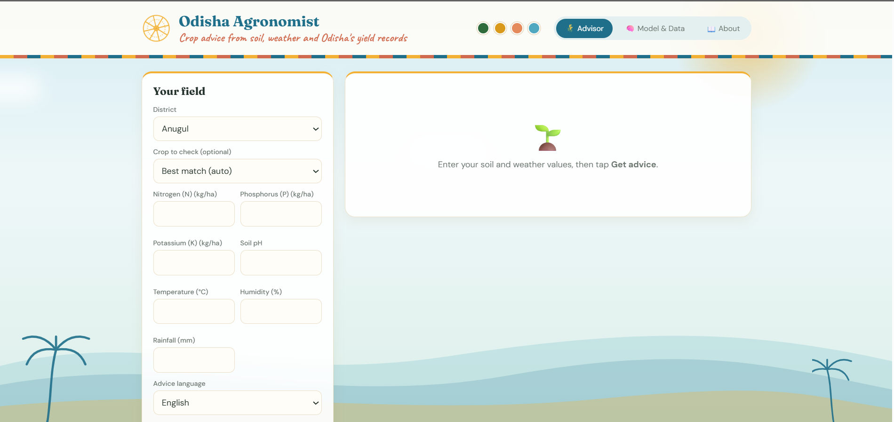
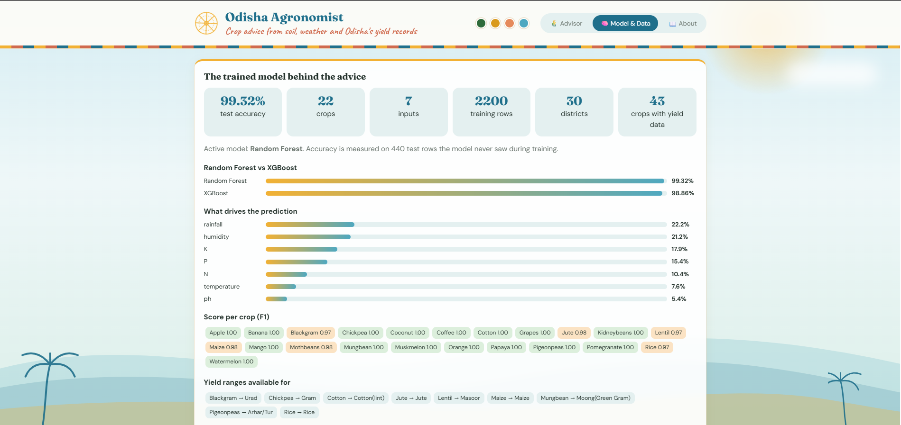

# Odisha Agronomist

A web app that helps Odisha farmers choose a crop. It takes the district, soil nutrients and weather, then gives:

1. **Optimal crop recommendation** – a Random Forest classifier scores 22 crops for the field.
2. **Yield forecast** – the typical yield range for that crop and district, taken from Odisha's historical records.
3. **AI Agronomist action plan** – a sowing schedule, fertilizer management and irrigation strategy written by an LLM, in English, Odia, Hindi, Bengali or Telugu.

**Live app:** https://odisha-agronomist-mm4j.onrender.com/

_The app runs on Render's free plan, so the first visit after a quiet period can take 30 to 60 seconds to wake up._

## Screenshots

**Advisor** – enter the district, soil and weather values to get crop matches, a yield range and the action plan.



**Model & Data** – accuracy, Random Forest vs XGBoost, what drives the prediction and score per crop.



**About** – how the app works, the data behind it and the team.


## Inputs

| Input | Details |
|---|---|
| District | Any of Odisha's 30 districts in the yield records |
| Soil nutrients | Nitrogen, phosphorus, potassium (kg/ha) and soil pH |
| Soil type | One of Odisha's 8 soil groups (defaults to the main soil of the district); fills the typical pH and shows the soil's N, P, K status |
| Season | Kharif (Jun–Oct), Rabi (Nov–Feb) or Zaid (Mar–May) |
| Weather | Temperature (°C), humidity (%), rainfall (mm per month in the season). Filled in automatically from the district's 2019–2023 averages; can be changed |
| Language | English, Odia, Hindi, Bengali, Telugu |
| Crop to check (optional) | See the suitability of a specific crop |

## How it works

- **Crop classifier:** trained on the Kaggle Crop Recommendation dataset (22 crops). Random Forest scored 99.3% and XGBoost 98.9% on a held-out 20% test split (5-fold cross-validation gives the same picture); Random Forest is used. This dataset is synthetic and very easy (a single decision tree also scores about 99%), so treat the accuracy as a demonstration figure, not field accuracy.
- **Yield ranges:** built from the Indian crop production dataset, filtered to Odisha (29,625 rows, 30 districts, 43 crops). The app shows the 25th to 75th percentile of past yields (tonnes per hectare), not a model prediction.
- **Action plan:** the crop, soil, weather and yield range are sent to an LLM prompted to act as an Odisha agronomist, through the OpenAI Python library. Groq is used if `GROQ_API_KEY` is set, otherwise xAI (`XAI_API_KEY`), otherwise OpenAI (`OPENAI_API_KEY`). Answers are cached and limited to 6 AI calls per visitor per minute (`AI_CALLS_PER_MINUTE`).
- **Guard rails:** inputs are only accepted inside the range the model was trained on, crops not grown in Odisha (apple, grapes; change with `EXCLUDED_CROPS`) are never recommended, and a top score under 40% is shown as "no strong match".

## Data notes and limitations

- No values in the source datasets were added or changed. The yield file was only filtered to Odisha.
- About half of the yield values in the source data are recorded in a different unit (for example rice at 150+ t/ha), and all rows from 2016 onward are affected. A yield prediction model trained on this data performed worse than a plain average, so the app shows a typical range instead. Rows with implausible yields are left out **only when the range is summarised**, never from the dataset.
- The crop dataset has no district column, so the district affects the yield range and the AI advice, not the crop score.
- 13 of the 22 crops (for example apple, mango, banana) have no Odisha yield records; the app shows suitability only for them. Crops with few records (for example cotton) are flagged as low confidence.
- Crop suggestions are most reliable for Kharif. The crop dataset has no mustard, groundnut, potato, wheat or vegetables, so Rabi and Zaid suggestions are limited; the app says so with each Rabi or Zaid result.
- Soil type: districts, pH and N/P/K status (low / medium / high) come from "Soil of Orissa and Its Management", Orissa Review (Govt. of Odisha), Nov 2005. Only pH is filled in. N/P/K status is shown as text, because the crop dataset's N/P/K behave like the nutrients a field receives (rice rows have a median of 80:47:40, close to a fertilizer dose), not the soil's own status: filling "low" status values made the model suggest coconut for most Kharif fields.
- Advice is guidance only. Confirm doses and dates with the local Krishi Vigyan Kendra.

## Project structure

```
app.py                         Flask backend (loads both models with joblib)
templates/index.html           Web interface
models/crop_model.pkl          Random Forest crop classifier
models/yield_stats.pkl         Yield ranges per crop and district
data/processed/                Odisha yield data and crop recommendation data
odisha_crop_advisory_v5.ipynb  Notebook that builds the two .pkl files
build_district_climate.py      Builds data/processed/district_climate.csv (typical weather per district and season)
requirements.txt
```

## Run locally

```bash
pip install -r requirements.txt
```

Create a file named `.env` next to `app.py` (it is git-ignored) with one of:

```
GROQ_API_KEY=your_key
# XAI_API_KEY or OPENAI_API_KEY also work
```

```bash
python app.py
```

Open http://127.0.0.1:5000. Without a key, crop matches and yield ranges still work; only the action plan needs it.

## District weather table

`data/processed/district_climate.csv` holds the typical temperature, humidity and monthly rainfall for each district headquarters and season (2019–2023, Open-Meteo historical API, ERA5 reanalysis). It is built once and committed, so the app makes no weather calls at runtime:

```bash
python build_district_climate.py
```

Downloads are cached in `data/raw/climate_cache/` (git-ignored). Without the CSV the app still works; weather is then entered by hand.

## Deploy on Render

- Build command: `pip install -r requirements.txt`
- Start command: `gunicorn app:app --workers 1 --timeout 300`
- Environment variable: `GROQ_API_KEY` (or `XAI_API_KEY` / `OPENAI_API_KEY`)

## Retrain the models

```bash
pip install -r requirements.txt -r requirements-dev.txt
jupyter nbconvert --to notebook --execute --inplace odisha_crop_advisory_v5.ipynb
```

This rebuilds both `.pkl` files. Train with the same scikit-learn version as `requirements.txt`, because the app loads the model with that version.

## Team Members

| Name |
|---|
| Shibang Maity |
| Priyanshu Sekhar Bhuyan |
| Roshan Panda |
| M.Tanisha |
| Rishav Kumar Shrivastava |
| Divyansh Singh |

Contributions go through GitHub.

## Data sources

- Indian crop production yield dataset (Kaggle)
- Crop Recommendation dataset (Kaggle)
- Soil of Orissa and Its Management, Orissa Review, Government of Odisha, November 2005
- Open-Meteo historical weather API (ERA5 reanalysis), 2019–2023
